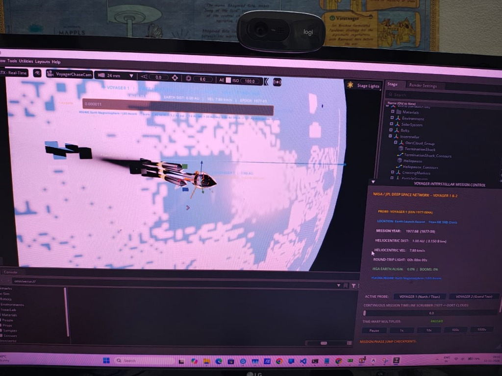
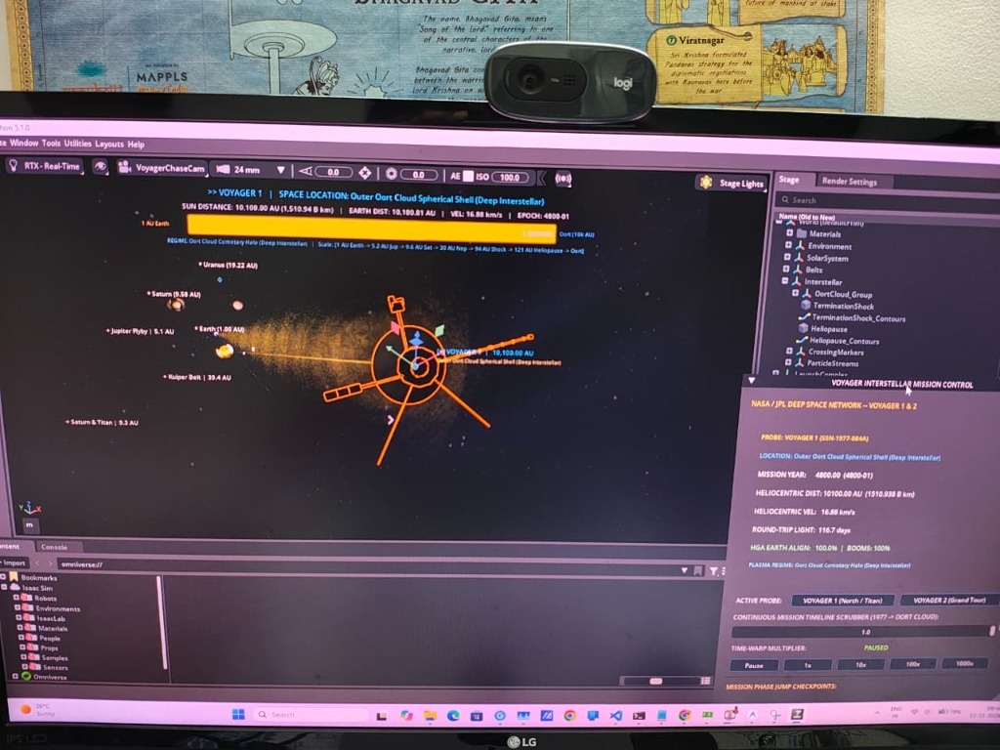
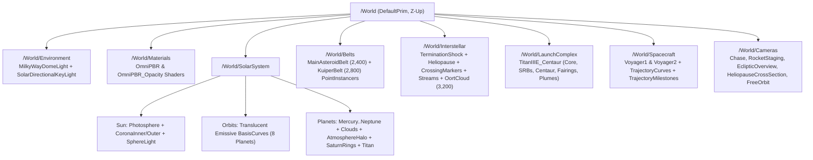

# Voyager 1 & 2 Interstellar Journey — 3D OpenUSD Simulation in NVIDIA Isaac Sim

[](https://developer.nvidia.com/isaac-sim)
[](https://openusd.org/)
[](https://www.python.org/)
[](LICENSE)

A complete, interactive, scientifically grounded 3D OpenUSD simulation built for **NVIDIA Isaac Sim 5.x** depicting the historic interstellar missions of **Voyager 1** and **Voyager 2** — from **Titan IIIE / Centaur launch & articulated boom deployment at Earth (1977)** through the **Planetary Grand Tour**, **Main Asteroid & Kuiper Belts**, **Termination Shock & Heliopause crossing (~121 AU)**, **Oort Cloud**, and **present-day Interstellar Space (166+ AU)**.

---

## Key Visual & Scientific Highlights

- **Phase 1 — Launch, Staging & Articulated Boom Unfolding (1977):**
  - Liftoff off sunlit **Earth** aboard the **Titan IIIE / Centaur** launch vehicle with animated Solid Rocket Booster (SRB) separation, payload fairing clamshell jettison, emissive thruster plumes, and co-moving patched-conic Earth escape hyperbola.
  - Articulated **Voyager 1 & 2** spacecraft featuring a 3.7 m parabolic High-Gain Antenna (HGA), decagonal bus, gold-anodized **Voyager Golden Record**, unfolding 13 m fiberglass **Astromast magnetometer boom**, unfolding 3-cylinder **MHW-RTG nuclear boom**, and 2-axis **Science Scan Platform** (composed with converted NASA 3D Resources reference metadata).
- **Phase 2 — Planetary Grand Tour & Gravity Assists (1979–1989):**
  - Blazing **Sun** (`SphereLight` + sun-tracking directional key light + dual-shell volumetric corona) surrounded by a Milky Way `DomeLight`.
  - All **8 Solar System planets** rendered at grand cinematic scale relative to the spacecraft (~`92x` Earth-to-dish world bound ratio) with accurate Keplerian 3D orbits, axial tilts, sidereal rotation, physically-based `OmniPBR` sunlight reflection, Earth ocean/continent roughness & tangent-space RGB normal maps, Rayleigh atmospheric rim halos, and **Saturn's** translucent Cassini-division rings + orbiting **Titan**.
  - Smooth Catmull-Rom trajectories for **Voyager 1** (*Earth -> Jupiter -> Saturn -> Titan -> +35 deg North ecliptic exit*) and **Voyager 2** (*Earth -> Jupiter -> Saturn -> Uranus -> Neptune -> -44 deg South ecliptic exit*), continuously locking each probe's High-Gain Antenna onto moving Earth (`dot = +1.0000`).
- **Phase 3 — Main Asteroid Belt & Kuiper Belt (`UsdGeom.PointInstancer`):**
  - **9,600 GPU-instanced bodies & plasma streaks** across 5 `UsdGeom.PointInstancer` prims (`MainAsteroidBelt`: 2,400 silicate/carbonaceous rocks; `KuiperBelt`: 2,800 icy planetesimals; `OortCloud`: 3,200 cometary nuclei; `SolarWindStream`: 550 ions; `CosmicRayStream`: 650 VLISM streaks) running smoothly in **~2.7 GB VRAM** (`< 8 GB` budget).
- **Phase 4 — Heliosphere, Termination Shock & Heliopause (~121 AU):**
  - Rankine/VLISM-deformed teardrop **Termination Shock** (~90 AU nose) and **Heliopause** (~121 AU nose + stretched downwind heliotail) using custom translucent `OmniPBR_Opacity` plasma drapery maps and glowing **2012 (Voyager 1)** & **2018 (Voyager 2)** crossing beacons.
- **Phase 5 & 6 — Oort Cloud & Present-Day Interstellar Cruise (2026+):**
  - Spherical **Oort Cloud** cometary halo spanning `1,050 - 24,000 AU` and real-time 2026 Very Local Interstellar Medium (VLISM) telemetry (`166.4 AU` for Voyager 1, `139.5 AU` for Voyager 2).
- **Translucent Holographic Curves & Dual HUDs:**
  - Camera-adaptive `UsdGeom.BasisCurves` (`0.010 m` trajectory / `0.004 m` radio sightline in close cameras; `0.28 m` / `0.12 m` in wide overviews) bound to translucent emissive `OmniPBR_Opacity` materials so spacecraft hardware is never occluded.
  - Interactive **`omni.ui` Mission Control Window** paired with an **In-Viewport 3D AU & Space Location HUD** (`VoyagerViewportHUD`) featuring a top telemetry ribbon, logarithmic `1 AU -> 10,000 AU` progress bar, and 3D-projected floating viewport callouts.

---

## Live Viewport Showcase & Image Annotations

### 1. Phase 1 — Titan IIIE / Centaur Earth Launch Ascent (`T = 1977.68`, `1.00 AU`)



* **Scene State (`scrub_s = 0.0`, `VoyagerChaseCam`, RTX Real-Time):** Captures **Voyager 1** stowed inside the **Titan IIIE / Centaur** payload fairing immediately after ignition off Earth's sunlit limb, with twin UA1205 Solid Rocket Boosters (SRBs), core stage, and thruster plume geometry visible against the towering Earth horizon.
* **Spacecraft State & Curves:** `HGA EARTH ALIGN: 0.0% | BOOMS: 0%` (magnetometer Astromast, MHW-RTG boom, and science scan platform folded prior to Centaur separation), while the thin translucent `Voyager1_Trajectory` `BasisCurves` filament traces the outward interplanetary departure arc.
* **Live HUD Telemetry:** `LOCATION: Earth Launch Ascent -- Titan IIIE SRB Climb` | `HELIOCENTRIC DIST: 1.00 AU (0.150 B km)` | `EARTH DIST: 0.00 AU` | `HELIOCENTRIC VEL: 7.80 km/s` | `ROUND-TRIP LIGHT: 00h 00m 00s` | `PLASMA REGIME: Earth Magnetosphere / LEO Ascent`.

### 2. Deep Interstellar Cruise — Outer Oort Cloud Spherical Shell (`Year 4800.00`, `10,100.00 AU`)



* **Scene State (`scrub_s = 1.0`, `VoyagerChaseCam`, RTX Real-Time):** Close chase view of **Voyager 1** in deep interstellar space inside the outer **Oort Cloud** cometary halo (`4800-01`), highlighting its fully deployed aerospace geometry — decagonal bus, 3.7 m parabolic High-Gain Antenna dish, 13 m Astromast magnetometer boom, 3-cylinder MHW-RTG arm, Science Scan Platform, and dual PRA whip antennas.
* **Unobscured Translucent Sightline & 3D Callouts:** The razor-thin translucent amber `Voyager1_EarthRadioLink` curve (`0.004 m` close width) stretches cleanly from the High-Gain Dish boresight (`HGA EARTH ALIGN: 100.0% | BOOMS: 100%`) straight back toward the distant Solar System & Heliosphere glow. Floating 3D-projected viewport callouts simultaneously pinpoint `Earth (1.00 AU)`, `Jupiter Flyby | 5.1 AU`, `Saturn (9.58 AU)`, `Saturn & Titan | 9.3 AU`, `Uranus (19.22 AU)`, `Kuiper Belt | 39.4 AU`, and `[+] VOYAGER 1 | 10,100.00 AU`.
* **Live HUD Telemetry:** Top `VoyagerViewportHUD` ribbon & Mission Control card read `SUN DISTANCE: 10,100.00 AU (1,510.94 B km)` | `EARTH DIST: 10,100.81 AU` | `VEL: 16.88 km/s` | `ROUND-TRIP LIGHT: 116.7 days` | `PLASMA REGIME: Oort Cloud Cometary Halo (Deep Interstellar)` with the logarithmic progress bar filled to `1.000000` (`Oort (10k AU)`).

---

## Script Reference & Documentation Index

For a full function-by-function technical breakdown of every module in `voyager_interstellar_sim/`, see **[`docs/SCRIPT_REFERENCE.md`](docs/SCRIPT_REFERENCE.md)**:

| # | Script | Layer | Responsibility | Detailed Reference |
| :---: | :--- | :--- | :--- | :--- |
| **1** | [`__init__.py`](voyager_interstellar_sim/__init__.py) | Package | Package initialization & `__version__` metadata | [Section 1 — `__init__.py`](docs/SCRIPT_REFERENCE.md#1-__init__py) |
| **2** | [`config.py`](voyager_interstellar_sim/config.py) | Foundation | Astronomical constants, piecewise-log AU↔meter scaling, J2000 ephemerides & presets | [Section 2 — `config.py`](docs/SCRIPT_REFERENCE.md#2-configpy) |
| **3** | [`fetch_and_convert_assets.py`](voyager_interstellar_sim/fetch_and_convert_assets.py) | Assets & USD | NASA 3D Resources downloader, Kit `.glb`→`.usd` converter, textures & articulated USDs | [Section 3 — `fetch_and_convert_assets.py`](docs/SCRIPT_REFERENCE.md#3-fetch_and_convert_assetspy) |
| **4** | [`materials_vfx.py`](voyager_interstellar_sim/materials_vfx.py) | Shaders & Meshes | `OmniPBR` / `OmniPBR_Opacity` MDL builders, ocean roughness/RGB normal maps & teardrop shells | [Section 4 — `materials_vfx.py`](docs/SCRIPT_REFERENCE.md#4-materials_vfxpy) |
| **5** | [`kinematics.py`](voyager_interstellar_sim/kinematics.py) | Astrodynamics | Keplerian solver, V1/V2 Catmull-Rom splines, launch staging & DSN telemetry | [Section 5 — `kinematics.py`](docs/SCRIPT_REFERENCE.md#5-kinematicspy) |
| **6** | [`scene_builder.py`](voyager_interstellar_sim/scene_builder.py) | OpenUSD Scene | Full `/World` stage assembly, GPU `PointInstancer`s, adaptive `BasisCurves` & 5-camera rig | [Section 6 — `scene_builder.py`](docs/SCRIPT_REFERENCE.md#6-scene_builderpy) |
| **7** | [`ui_mission_control.py`](voyager_interstellar_sim/ui_mission_control.py) | UI & Control | `MissionController`, `VoyagerViewportHUD` 3D callouts & Mission Control window | [Section 7 — `ui_mission_control.py`](docs/SCRIPT_REFERENCE.md#7-ui_mission_controlpy) |
| **8** | [`main_voyager_sim.py`](voyager_interstellar_sim/main_voyager_sim.py) | Entry Point & QA | CLI launcher, Isaac Sim `SimulationApp` loop & `--headless --verify` test suite | [Section 8 — `main_voyager_sim.py`](docs/SCRIPT_REFERENCE.md#8-main_voyager_simpy) |

*Additional architecture notes:* [`IMPLEMENTATION_PLAN.md`](IMPLEMENTATION_PLAN.md)

---

## Architecture & Repository Layout

```text
Voyager-Interstellar-Simulation/
├── README.md                                    # Project documentation & quick-start guide
├── IMPLEMENTATION_PLAN.md                       # OpenUSD prim hierarchy, MDL mapping & scaling math
├── LICENSE                                      # MIT License + NASA public-domain asset notice
├── requirements.txt                             # Python package reference (bundled with Isaac Sim)
├── .gitignore                                   # Python, Omniverse Kit & OS ignore rules
├── .gitattributes                               # Cross-platform line-ending & binary asset rules
├── run_simulation.bat                           # One-click Windows interactive GUI launcher
├── verify_headless.bat                          # One-click Windows headless verification runner
├── docs/
│   ├── SCRIPT_REFERENCE.md                      # Detailed indexed documentation of every Python script
│   └── images/
│       ├── phase1_earth_launch_ascent.jpg       # Phase 1 Earth launch ascent viewport capture
│       └── phase5_outer_oort_cloud_interstellar.jpg  # Outer Oort Cloud deep interstellar viewport capture
└── voyager_interstellar_sim/
    ├── __init__.py
    ├── config.py                                # Ephemerides, constants, piecewise-log AU<->sim math
    ├── fetch_and_convert_assets.py              # Automated NASA GLB/texture fetcher, USD converter & fallbacks
    ├── kinematics.py                            # Keplerian solver, V1/V2 splines, staging & DSN telemetry
    ├── materials_vfx.py                         # OmniPBR / OmniPBR_Opacity builders, normal maps & shells
    ├── scene_builder.py                         # Full OpenUSD stage assembly, PointInstancers & 5-camera rig
    ├── ui_mission_control.py                    # Mission Control window + In-Viewport 3D AU/Location HUD
    ├── main_voyager_sim.py                      # Standalone Isaac Sim 5.x launcher & autonomous test suite
    ├── assets_raw/
    │   └── nasa_voyager.glb                     # Public-domain NASA 3D Resources Voyager model
    └── assets_usd/
        ├── asset_manifest.json                  # Portable relative asset manifest
        ├── voyager_nasa_converted.usd           # Converted NASA Voyager USD reference
        ├── voyager_articulated.usd              # Articulated Voyager OpenUSD (booms, scan platform, HGA)
        ├── titan_iiie_centaur.usd               # Multi-stage Titan IIIE / Centaur launch vehicle OpenUSD
        ├── asteroid_prototypes.usd              # 6 displaced FBM rock/ice prototypes for PointInstancers
        ├── voyager_complete_scene.usda          # Exported root OpenUSD stage snapshot
        ├── verification_report.txt              # Latest autonomous headless verification log
        └── textures/                            # Planetary albedo, cloud, ring, normal, roughness & VFX maps
```

### OpenUSD Stage Hierarchy



---

## Piecewise Logarithmic Radial Scaling

Spanning $10^{-4}\text{ AU}$ (Earth launch ascent) to $24,000\text{ AU}$ (Oort Cloud) in raw 1:1 coordinates ($3.6 \times 10^{15}\text{ m}$) would cause severe `float32` vertex jitter and render planets sub-pixel. [`config.py`](voyager_interstellar_sim/config.py) maps true heliocentric distance $r$ (in AU) monotonically onto a jitter-free $\sim 3,500\text{ m}$ OpenUSD stage while displaying exact astronomical AU, km/s, and round-trip light time on the HUD:

| Regime | Heliocentric Range | Radial Mapping $R_{\text{sim}}(r)$ | Key Landmarks |
| :--- | :--- | :--- | :--- |
| **I. Inner Solar System** | $0 \le r \le 2.0\text{ AU}$ | $240 \cdot \dfrac{\ln(1 + 2.2 r)}{\ln(3.2)}$ | Sun ($0\text{ m}$), Earth ($240\text{ m}$), Mars ($304\text{ m}$) |
| **II. Giant Planets & Kuiper** | $2.0 < r \le 55.0\text{ AU}$ | $R_1 + 330 \ln(r / 2.0)$ | Jupiter ($665\text{ m}$), Saturn ($866\text{ m}$), Neptune ($1,244\text{ m}$) |
| **III. Heliosheath & VLISM** | $55.0 < r \le 250.0\text{ AU}$ | $R_2 + 520 \ln(r / 55.0)$ | Termination Shock ($1,690\text{ m}$), Heliopause ($1,850\text{ m}$), V1 2026 ($2,019\text{ m}$) |
| **IV. Oort Cloud** | $r > 250.0\text{ AU}$ | $R_3 + 270 \ln(r / 250.0)$ | Inner Oort ($2,618\text{ m}$) to Outer Oort ($3,463\text{ m}$) |

---

## Prerequisites & Quick Start

### Requirements
- **OS:** Windows 10/11 (64-bit) or Linux (Ubuntu 22.04+)
- **GPU:** NVIDIA RTX GPU with $\ge 8\text{ GB}$ VRAM (verified at **2.68 GB VRAM** on RTX 5060 Laptop GPU)
- **Simulator:** **NVIDIA Isaac Sim 5.x** (default path `D:\0-NVIDIA-Omniverse\isaac-sim`, or set the `ISAAC_PATH` environment variable to your Isaac Sim root directory)

### 1. Launch the Full Interactive 3D Simulation (GUI)

Using the included batch launcher on Windows:
```cmd
.\run_simulation.bat
```

Or directly via Isaac Sim's `python.bat`:
```cmd
D:\0-NVIDIA-Omniverse\isaac-sim\python.bat .\voyager_interstellar_sim\main_voyager_sim.py
```

*(Optional CLI flags: `--spacecraft {1,2}` to start on Voyager 1 or 2, and `--phase {1..6}` to jump directly to a mission phase on startup.)*

### 2. Run the Autonomous Headless Verification Suite

```cmd
.\verify_headless.bat
```
or:
```cmd
D:\0-NVIDIA-Omniverse\isaac-sim\python.bat .\voyager_interstellar_sim\main_voyager_sim.py --headless --verify
```

### 3. Re-Run Standalone Public-Domain Asset Fetcher & USD Converter *(Optional)*
All converted OpenUSD models and planetary/VFX textures are pre-cached in `voyager_interstellar_sim/assets_usd/`. To re-fetch or rebuild them from scratch:
```cmd
D:\0-NVIDIA-Omniverse\isaac-sim\python.bat .\voyager_interstellar_sim\fetch_and_convert_assets.py
```

---

## Interactive Mission Control & Viewport Controls

Once launched, use the **`VOYAGER INTERSTELLAR MISSION CONTROL`** panel alongside the **In-Viewport 3D AU & Location HUD**:

1. **Active Probe Selector:** Switch live telemetry, trajectory highlights, and chase cameras between **Voyager 1 (North / Titan)** and **Voyager 2 (Grand Tour)**.
2. **Continuous Mission Timeline Scrubber:** Scrub smoothly from `1977.68` (Cape Canaveral LC-41 ascent) past all planetary flybys and the Heliopause into the Oort Cloud (`4800 AD`).
3. **Time-Warp Multiplier:** `Pause`, `1x` cinematic, `10x`, `100x`, and `1000x` deep-space cruise speed.
4. **6 Instant Mission Phase Checkpoints:**
   - `1. Launch (1977)` — Titan IIIE SRB/fairing staging & Voyager boom deployment off sunlit Earth
   - `2. Jupiter (1979)` — Close Jovian gravity assist
   - `3. Saturn/Outer` — Saturn rings & Titan flyby (V1) / Uranus & Neptune Grand Tour (V2)
   - `4. Heliopause` — Crossing the teardrop Heliopause boundary (~121 AU) into the VLISM
   - `5. Oort Cloud` — Cruising through the spherical Oort Cloud cometary shell
   - `6. Now (2026)` — Present-day interstellar position (`166.40 AU` V1 / `139.50 AU` V2)
5. **5 Multi-Camera Modes:**
   - `Voyager Chase Cam` (dynamic planet-horizon framing)
   - `Rocket Staging Cam` (launch staging & close scan-platform inspection)
   - `Solar System Ecliptic Overview`
   - `Heliopause Cross-Section Cam`
   - `Free Orbit` (unlocked viewport navigation: `Alt + LMB` orbit, `Alt + MMB` pan, `Scroll` zoom)

---

## Autonomous Verification Summary

Verified via `main_voyager_sim.py --headless --verify` (full log in [`verification_report.txt`](voyager_interstellar_sim/assets_usd/verification_report.txt)):

- **Asset & MDL Resolution:** `88 / 88` `Sdf.AssetPath` attributes resolved (`0` missing references or textures).
- **Articulation & Attitude:** Phase 1 boom deployment `0.00 -> 0.99`; Phases 2–6 High-Gain Antenna Earth-tracking alignment `dot = +1.0000` for both Voyager 1 and Voyager 2.
- **Scale & Curve Visibility:** `92.7x` Earth-to-Voyager-dish world bound ratio; `0.010 m` / `0.004 m` translucent emissive `OmniPBR_Opacity` trajectory/radio curves verified.
- **Instancing & GPU Memory:** `440` total USD stage prims driving `9,600` GPU instances across `5` `PointInstancer`s using **2,678 MB / 8,151 MB VRAM**.

---

## Credits & License

- **Code:** Released under the [MIT License](LICENSE).
- **3D Reference Models & Planetary Maps:** Courtesy of [NASA 3D Resources](https://github.com/nasa/NASA-3D-Resources), NASA/JPL-Caltech, and NASA Scientific Visualization Studio (Public Domain / CC-BY).
