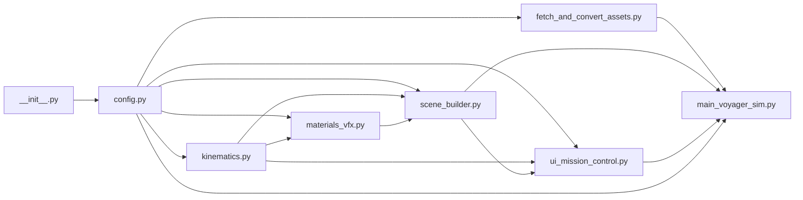

# Voyager Interstellar Simulation — Complete Script & Module Reference

Detailed architectural and symbol-level documentation for every Python module inside [`voyager_interstellar_sim/`](../voyager_interstellar_sim/).

---

## Quick Script Index

| # | Script | Layer | Primary Responsibility | Anchored Section |
| :---: | :--- | :--- | :--- | :--- |
| **1** | [`__init__.py`](../voyager_interstellar_sim/__init__.py) | Package | Package marker and version metadata (`__version__`) | [1. `__init__.py`](#1-__init__py) |
| **2** | [`config.py`](../voyager_interstellar_sim/config.py) | Foundation | Astronomical constants, piecewise-log AU ↔ meters scaling, J2000 ephemerides & mission timeline presets | [2. `config.py`](#2-configpy) |
| **3** | [`fetch_and_convert_assets.py`](../voyager_interstellar_sim/fetch_and_convert_assets.py) | Assets & USD | NASA 3D Resources fetcher, equirectangular texture synthesizer, Kit USD converter & procedural vehicle/asteroid builders | [3. `fetch_and_convert_assets.py`](#3-fetch_and_convert_assetspy) |
| **4** | [`materials_vfx.py`](../voyager_interstellar_sim/materials_vfx.py) | Shaders & Meshes | `OmniPBR` / `OmniPBR_Opacity` MDL builders, ocean roughness & RGB normal maps, UV spheres, Saturn rings & teardrop Heliosphere shells | [4. `materials_vfx.py`](#4-materials_vfxpy) |
| **5** | [`kinematics.py`](../voyager_interstellar_sim/kinematics.py) | Astrodynamics | Keplerian planet solver, Catmull-Rom V1/V2 splines, Phase 1 rocket staging, HGA Earth-pointing quaternions & DSN telemetry | [5. `kinematics.py`](#5-kinematicspy) |
| **6** | [`scene_builder.py`](../voyager_interstellar_sim/scene_builder.py) | OpenUSD Scene | Full `/World` stage assembly, GPU `PointInstancer` belts/Oort Cloud, camera-adaptive translucent `BasisCurves`, & 5-camera rig | [6. `scene_builder.py`](#6-scene_builderpy) |
| **7** | [`ui_mission_control.py`](../voyager_interstellar_sim/ui_mission_control.py) | UI & Control | `MissionController` state loop, `VoyagerViewportHUD` 3D-projected overlay, & `VoyagerMissionControlWindow` panel | [7. `ui_mission_control.py`](#7-ui_mission_controlpy) |
| **8** | [`main_voyager_sim.py`](../voyager_interstellar_sim/main_voyager_sim.py) | Entry Point & QA | CLI entry point, Isaac Sim `SimulationApp` bootstrap, interactive loop, & `--headless --verify` test suite | [8. `main_voyager_sim.py`](#8-main_voyager_simpy) |

### Module Dependency Flow

---

## 1. `__init__.py`
**Source:** [`voyager_interstellar_sim/__init__.py`](../voyager_interstellar_sim/__init__.py)  
**Role:** Minimal package initialization file defining `__version__ = "1.0.0"` so all modules import cleanly via `voyager_interstellar_sim.*`.

---

## 2. `config.py`
**Source:** [`voyager_interstellar_sim/config.py`](../voyager_interstellar_sim/config.py)  
**Role:** Single source of truth for filesystem resolution, physical/astronomical constants, piecewise logarithmic distance transforms, J2000 planetary parameters, mission timeline knots, phase presets, and camera definitions.

### Key Components
- **Path & Isaac Sim Resolution:**
  - `PACKAGE_DIR`, `PROJECT_ROOT`, `ASSETS_RAW_DIR`, `ASSETS_USD_DIR`, `TEXTURES_DIR`, `KIT_MDL_BASE_DIR`, `SIMREADY_CENTRAL_DIR`.
  - `resolve_isaac_sim_root()`: Checks `$ISAAC_PATH`, then Windows (`D:/0-NVIDIA-Omniverse/isaac-sim`) and WSL (`/mnt/d/0-NVIDIA-Omniverse/isaac-sim`) paths.
- **Astronomical & VLISM Constants:**
  - `AU_KM` (`149,597,870.7 km`), `AU_BILLION_KM`, `SPEED_OF_LIGHT_KM_S` (`299,792.458 km/s`), `CurrentEpochYear` (`2026.865`).
  - `HELIO_NOSE_DIR` & `ISM_INFLOW_DIR`: Heliosphere nose unit vector calibrated to ecliptic longitude `255.4 deg`, latitude `+5.2 deg` opposing the incoming Very Local Interstellar Medium (VLISM) flow.
- **Piecewise Logarithmic Radial Scaling & Apparent Scale:**
  - Constants `R0_EARTH_SIM_M = 240.0`, `ALPHA_INNER = 2.2`, `S2_PLANETARY_M = 330.0`, `S3_HELIOSPHERE_M = 520.0`, `S4_OORT_M = 270.0`.
  - `SUN_VISUAL_RADIUS_M = 34.0`, `SPACECRAFT_VISUAL_SCALE = 0.12`, `ROCKET_VISUAL_SCALE = 0.032`.
  - `au_to_sim_radius(r_au)` & `sim_radius_to_au(r_sim)`: Exact invertible 4-regime piecewise logarithmic mapping (`0–2 AU`, `2–55 AU`, `55–250 AU`, `>250 AU`) keeping all stage geometry within `~3,600 m` for jitter-free `float32` RTX precision.
  - `au_vec_to_sim(vec_au)`: Maps 3D ecliptic AU coordinates radially into scene meters.
- **Planetary & Mission Data Structures:**
  - `PlanetSpec` & `PLANETS` / `PLANET_BY_NAME`: Complete J2000 orbital elements (`a_au`, `ecc`, `inc_deg`, `raan_deg`, `arg_peri_deg`, `mean_lon_1977_deg`, `period_years`), physical/visual radii, axial tilts, sidereal rotation periods, PBR `roughness` / `specular`, atmosphere halo colors/opacities, and ring flags for all 8 planets.
  - `TIMELINE_KNOTS`, `scrub_to_year(s)`, `year_to_scrub(year)`: Piecewise linear mapping between normalized timeline scrubber `s in [0.0, 1.0]` and mission year `1977.679 -> 4800.0`.
  - `PhasePreset`, `MISSION_PHASES` (6 phase jump presets for both V1 & V2), and `CAMERA_MODES` (5 named camera views).

---

## 3. `fetch_and_convert_assets.py`
**Source:** [`voyager_interstellar_sim/fetch_and_convert_assets.py`](../voyager_interstellar_sim/fetch_and_convert_assets.py)  
**Role:** Idempotent asset acquisition, conversion, texture synthesis, and OpenUSD assembly pipeline. Can be run standalone via `D:\0-NVIDIA-Omniverse\isaac-sim\python.bat ./voyager_interstellar_sim/fetch_and_convert_assets.py`.

### Key Functions
- **`scan_local_simready_and_mdl()`:** Indexes any local `.usd`/`.usda`/`.usdc`/`.mdl` assets in `SIMREADY_CENTRAL_DIR` and catalogs Isaac Sim's core `KIT_MDL_BASE_DIR` shaders (`OmniPBR.mdl`, `OmniPBR_Opacity.mdl`, etc.).
- **`discover_and_download_nasa_models()`:** Queries `nasa/NASA-3D-Resources` GitHub tree API (or cached `assets_raw/`) to download the public-domain Voyager `.glb` model (`nasa_voyager.glb`) and any matching Titan IIIE / Centaur launch vehicle model.
- **`build_or_fetch_textures()`:** Caches public-domain planetary textures (`earth`, `earth_bump`, `earth_clouds`, `mercury`, `jupiter`, `mars`) as clean local PNGs and deterministically synthesizes seamless spherical FBM/procedural equirectangular maps for `sun`, `venus`, `saturn`, `saturn_rings` + `saturn_rings_opacity` (Cassini Division & Encke Gap), `uranus`, `neptune`, `titan`, `asteroid_rock`, `kuiper_ice`, and the 2048×1024 `milky_way_starfield.png` panorama (14,000 multi-spectral stars).
- **`_convert_mesh_with_kit(input_mesh, output_usd)`:** Uses `omni.kit.asset_converter` to convert `.glb`/`.obj`/`.fbx`/`.stl` into Z-up, 1-meter-unit `.usd` files.
- **`build_voyager_articulated_usd(output_usd, converted_nasa_usd)`:** Constructs `/Voyager` (`voyager_articulated.usd`) with Z-up axes, `OmniPBR` materials + `UsdPreviewSurface` fallbacks, decagonal bus, gold Kapton hydrazine tank, **Voyager Golden Record**, 3.7 m parabolic **High-Gain Dish** (`+Z` Earth boresight), feed subreflector/struts, unfolding 13 m lattice **MagnetometerBoomPivot**, unfolding 3-cylinder **RTGBoomPivot**, 2-axis **ScanPlatformPivot** (`ISS_NarrowAngleCam`, `IRIS_Radiometer`), and dual whip antennas.
- **`build_titan_iiie_centaur_usd(output_usd)`:** Builds `/TitanIIIE` (`titan_iiie_centaur.usd`) with independently animatable Xform ops (`sep`, `peel`, `throttle`) across `CoreStage`, `SRB_Left` / `SRB_Right`, `CentaurStage`, `Fairing_Left` / `Fairing_Right`, and emissive SRB / Hydrolox thruster plumes.
- **`build_asteroid_prototypes_usd(output_usd)`:** Generates 6 multi-octave displaced FBM asteroid/comet prototypes (`Proto_Silicate_0`, `Proto_Silicate_1`, `Proto_Carbonaceous_2`, `Proto_KuiperIce_3`, `Proto_KuiperTholin_4`, `Proto_OortComet_5`) for low-VRAM GPU instancing.
- **`ensure_all_assets_ready(app_already_running)`:** Orchestrates the entire scan → download → convert → synthesize flow and writes `assets_usd/asset_manifest.json`.

---

## 4. `materials_vfx.py`
**Source:** [`voyager_interstellar_sim/materials_vfx.py`](../voyager_interstellar_sim/materials_vfx.py)  
**Role:** Procedural VFX texture generators, Omniverse RTX MDL material factory (`OmniPBR` / `OmniPBR_Opacity`), and high-tessellation USD mesh/curve builders.

### Key Functions
- **`ensure_vfx_textures()`:** Generates and caches specialized VFX maps in `assets_usd/textures/`:
  - `vfx_heliopause_color.png` & `vfx_heliopause_opacity.png` (cyan nose glow transitioning to violet heliotail plasma filaments).
  - `vfx_corona_opacity.png` (equatorial solar streamer opacity).
  - `earth_roughness.png` (derived from `earth.png` to differentiate `0.15` glossy specular oceans, `0.36` polar ice, and `0.82` matte continents).
  - `earth_normal.png`, `mercury_normal.png`, `mars_normal.png` (tangent-space RGB normal maps synthesized via central-difference height gradients).
- **`create_omnipbr_material(...)`:** Defines a `UsdShade.Material` targeting `OmniPBR.mdl` or `OmniPBR_Opacity.mdl` (depending on opacity inputs) with diffuse, normal, roughness, specular, metallic, emission, and opacity parameters, plus a `UsdPreviewSurface` fallback output for non-MDL renderers.
- **`define_uv_sphere_mesh(...)`:** Creates a Z-up equirectangular UV sphere mesh with smooth vertex normals and `st` primvars for planets, Sun, atmosphere halos, clouds, and moons.
- **`define_annulus_ring_mesh(...)`:** Creates a double-sided XY annulus mesh mapped radially (`u in [0, 1]`) for Saturn's rings and crossing beacon halos.
- **`define_heliosphere_teardrop_shell(...)`:** Generates the ISM-deformed teardrop mesh (and optional rib/meridian `UsdGeom.BasisCurves`) for the Termination Shock and Heliopause shells using `heliosphere_boundary_radius_au`.

---

## 5. `kinematics.py`
**Source:** [`voyager_interstellar_sim/kinematics.py`](../voyager_interstellar_sim/kinematics.py)  
**Role:** Astronomical ephemeris solver, Catmull-Rom Grand Tour & Interstellar spline evaluation, Phase 1 launch staging kinematics, spacecraft attitude quaternions, and telemetry formatting.

### Key Functions & Dataclasses
- **Keplerian Mechanics:**
  - `solve_kepler(mean_anomaly_rad, ecc)`: Newton-Raphson solver for Kepler's equation $E - e \sin E = M$.
  - `planet_position_au(spec, year)` & `planet_position_sim(spec, year)`: J2000 3D ecliptic heliocentric propagation mapped into piecewise-log simulation meters.
  - `sample_orbit_curve_sim(spec, num_samples)` & `planet_spin_deg(spec, year)`.
- **Heliosphere & Voyager Splines:**
  - `heliosphere_boundary_radius_au(direction_unit, nose_au, tail_stretch)`: Rankine-Parker teardrop profile aligned to `HELIO_NOSE_DIR` (`~121.6 AU` along Voyager 1's asymptotic path, stretching `2.55x` downwind into the heliotail).
  - `TrajectoryKnot`, `VOYAGER1_KNOTS`, `VOYAGER2_KNOTS`, `_catmull_rom_eval(knots, year)`: $C^1$ Catmull-Rom interpolation across trailing sunlit planetary gravity-assist flanks, heliosheath crossings, 2026 VLISM positions, and Oort Cloud targets (`10,100 AU` V1 / `9,050 AU` V2 at year 4800).
  - `sample_voyager_curve_sim(spacecraft_id, num_samples)`: Mixed linear inner + geomspace outer spline sampling for `UsdGeom.BasisCurves`.
  - `get_heliopause_crossing_sim(spacecraft_id)` & `get_trajectory_au_milestones(spacecraft_id)`.
- **Attitude & Frame State Evaluator:**
  - `quat_look_along_plus_z(target_dir, up_hint)`: Builds orthonormal `(w, x, y, z)` attitude quaternion aligning local `+Z` (HGA dish boresight) onto `target_dir`.
  - `RocketStageState`, `SpacecraftState`, `SimulationFrameState`.
  - `_format_rtlt(earth_dist_au)`, `_classify_plasma_regime(r_au, pos_sim)`, `_describe_space_location(...)`.
  - `evaluate_simulation_frame(scrub_s, active_spacecraft)`: Master per-frame evaluator computing all 8 planet poses, Titan's orbit, Phase 1 SRB/core/fairing/Centaur staging + patched-conic Earth SOI hyperbola blend (`1977.685 -> 1977.90`), unfolding boom fraction `boom_deploy_01`, and both spacecraft states + telemetry.

---

## 6. `scene_builder.py`
**Source:** [`voyager_interstellar_sim/scene_builder.py`](../voyager_interstellar_sim/scene_builder.py)  
**Role:** Builds the complete `/World` OpenUSD scene hierarchy, caches `UsdGeom.XformOp` handles for fast per-frame updates, populates GPU `PointInstancer` belts, and drives all 5 mission cameras.

### Key Components
- **`make_camera_transform_matrix(eye, target, up_world)`:** Constructs a row-major `Gf.Matrix4d` camera-to-world transform (row 2 = `-forward` for USD cameras).
- **`_resolve_portable_asset(raw_path, fallback_dir, default_name)`:** Resolves texture and USD paths portably across Windows/Linux clones even when `asset_manifest.json` moves machines.
- **`VoyagerSceneManager`:**
  - `build_full_scene()`: Configures Z-up / 1.0 m stage units, RTX settings (`/rtx/raytracing/fractionalCutoutOpacity = True`, bloom glare), and builds the full scene:
    1. `_build_environment_and_sun()`: Milky Way `DomeLight`, sun-tracking `DistantLight`, galactic fill light, incandescent `Sun/Photosphere`, rotating inner/outer corona shells, and `SolarSphereLight`.
    2. `_build_planets_and_orbits()`: Translucent emissive `BasisCurves` orbits (`0.10 m`), PBR planets with tangent-space normal/roughness maps, Rayleigh `AtmosphereHalo` shells, rotating `Earth/AxialTilt/CloudLayer`, double-sided `Saturn/AxialTilt/RingsAnnulusMesh`, and orbiting `TitanMoon`.
    3. `_build_belts_and_oort_instancers()`: GPU `UsdGeom.PointInstancer` systems for `MainAsteroidBelt` (2,400), `KuiperBelt` (2,800), and spherical `OortCloud` (3,200).
    4. `_build_heliosphere_and_streams()`: Teardrop `TerminationShock` & `Heliopause` meshes + translucent contour curves, pulsing `CrossingMarkers` beacons (`Voyager1_Heliopause_2012`, `Voyager2_Heliopause_2018`), and `SolarWindStream` (550) / `CosmicRayStream` (650) `PointInstancer`s.
    5. `_build_launch_complex_and_spacecraft()`: References `titan_iiie_centaur.usd` and `voyager_articulated.usd` (for both Voyager 1 & 2), binds translucent emissive `OmniPBR_Opacity` materials (`Mat_*_TrajCurve`, `Mat_*_RadioCurve`) onto `TrajectoryCurves`, creates `TrajectoryMilestones`, and caches deployment/beacon/radio ops.
    6. `_build_camera_rig()`: Defines `VoyagerChaseCam`, `RocketStagingCam`, `EclipticOverviewCam`, `HeliopauseCrossSectionCam`, and `FreeOrbitCam`.
  - `apply_frame_state(state, active_spacecraft, active_camera, dt_wall)`: Updates all planet orbits/spins, belt drift, beacon pulse, Titan IIIE staging, Voyager transforms/booms, HGA radio sightline (offset `+0.26 m` ahead of the HGA feed tip), and camera-adaptive curve widths (`0.010 m`/`0.004 m` close vs. `0.28 m`/`0.12 m` overview).
  - `update_cameras(...)` & `set_active_viewport_camera(camera_prim_path)`: Dynamically frames Voyager against nearby sunlit planets during launch and giant-planet flybys, updates overview cameras (zooming out dynamically into the Oort Cloud), and preserves manual `FreeOrbitCam` manipulation.

---

## 7. `ui_mission_control.py`
**Source:** [`voyager_interstellar_sim/ui_mission_control.py`](../voyager_interstellar_sim/ui_mission_control.py)  
**Role:** Headless-safe simulation controller paired with two synchronized `omni.ui` interfaces: the In-Viewport 3D HUD overlay and the Mission Control control panel window.

### Key Classes
- **`MissionController`:**
  - Holds simulation state (`active_spacecraft`, `scrub_s`, `speed_multiplier`, `active_camera`, `auto_camera_on_phase`).
  - Exposes `set_spacecraft`, `set_speed`, `set_camera`, `set_scrub`, `jump_to_phase`, and `step(dt_wall)` (`rate = BASE_SCRUB_RATE_PER_SEC * speed_multiplier ** 0.58`), notifying all registered UI callbacks.
- **`VoyagerViewportHUD`:**
  - Attaches an `omni.ui` overlay frame (`voyager.interstellar.viewport.hud.v2`) directly onto the active Isaac Sim viewport.
  - Renders the top-center telemetry & space-location banner (Sun AU, Earth AU, velocity, epoch, logarithmic `1 AU -> 10k AU` progress bar, and color-coded plasma regime).
  - Projects 3D world positions (active Voyager + planets + trajectory AU milestones) onto viewport pixel coordinates in real time via `_project_world_to_viewport`, applying top-banner avoidance and a `92 px` screen-space de-clutter radius across `MAX_CALLOUT_SLOTS = 9` floating callouts.
- **`VoyagerMissionControlWindow`:**
  - Creates the docked/floating `VOYAGER INTERSTELLAR MISSION CONTROL` window (`455 × 690 px`) with a pinned live telemetry card at the top and scrollable controls underneath:
    - Spacecraft selector (`VOYAGER 1 (North / Titan)` / `VOYAGER 2 (Grand Tour)`)
    - Continuous timeline scrubber (`0.0 -> 1.0`)
    - Time-warp buttons (`Pause`, `1x`, `10x`, `100x`, `1000x`)
    - 6 Mission Phase jump buttons
    - 5 Multi-Camera selector buttons

---

## 8. `main_voyager_sim.py`
**Source:** [`voyager_interstellar_sim/main_voyager_sim.py`](../voyager_interstellar_sim/main_voyager_sim.py)  
**Role:** Primary executable launcher for NVIDIA Isaac Sim 5.x (interactive GUI and automated headless verification).

### Key Functions
- **`parse_args()`:** Parses `--headless`, `--verify`, `--spacecraft {1,2}`, and `--phase {1..6}`.
- **`_query_vram_mb()`:** Queries active NVIDIA GPU VRAM usage via `nvidia-smi` for verification telemetry.
- **`run_verification_suite(sim_app, stage, controller)`:** Automated `--headless --verify` check validating:
  1. **Verify 1/3 — Asset & Shader Resolution:** Traverses every USD attribute on `/World` and confirms `0` missing textures, references, or `.mdl` paths, plus checks existence of `voyager_articulated.usd`, `titan_iiie_centaur.usd`, and `asteroid_prototypes.usd`.
  2. **Verify 2A–2D — Kinematics, Articulation, Scales & Curves:** Confirms Phase 1 boom deployment (`0 -> 1`), finite transforms & `dot >= 0.995` Earth-pointing HGA alignment across Phases 2–6 for both probes, `>= 25x` Earth-to-Voyager-dish scale ratio (`92.7x` verified), `<= 0.05 m` close-camera `BasisCurves` width with translucent+emissive `OmniPBR_Opacity` bindings, and valid camera matrices across all 5 `CAMERA_MODES`.
  3. **Verify 3/3 — Instancing & Memory Budget:** Verifies all 5 `UsdGeom.PointInstancer` prims (`MainAsteroidBelt`, `KuiperBelt`, `OortCloud`, `SolarWindStream`, `CosmicRayStream`), ensures prim count stays compact (`< 5000`), confirms VRAM usage `< 7600 MB`, and writes `assets_usd/verification_report.txt`.
- **`main()`:** Bootstraps `isaacsim.simulation_app.SimulationApp`, loads or builds assets + stage, exports `assets_usd/voyager_complete_scene.usda`, runs either `--verify` or the real-time GUI loop (`VoyagerMissionControlWindow` + `VoyagerViewportHUD`), and exits cleanly.
